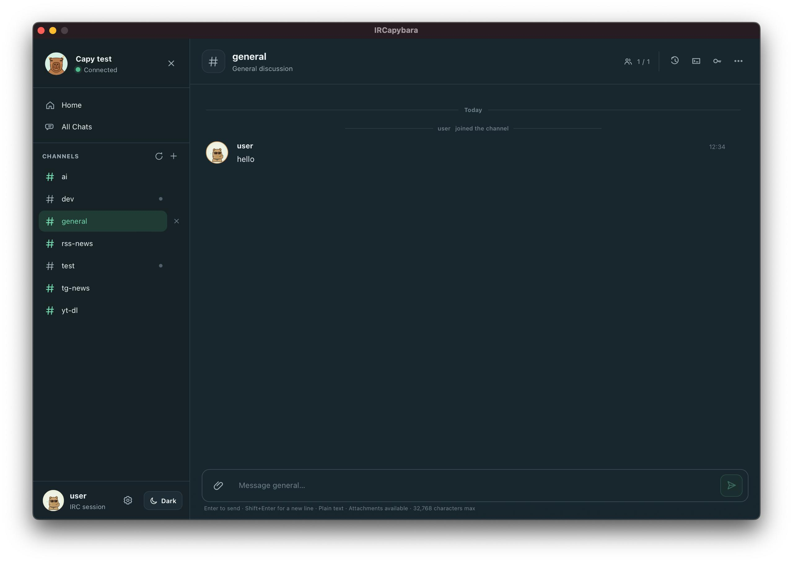

# IRCapybara

IRCapybara is an IRC client for desktop and Android. Both versions use the same Go code and web interface. The project also includes an IRC server you can host yourself, with optional integrations.

- [Client](client/README.md) — Wails app for Linux, macOS, and Windows. [CC BY-NC-SA 4.0](client/LICENSE)
- [Android client](client/android/README.md) — build and run the mobile app.
- [IRC server](server/README.md) — configure and run the server.
- [Project site source](docs/index.html) — overview and client screenshots.
- [GitHub Releases](https://github.com/remixer-dec/ircapybara/releases) — client and Linux x86-64 server packages are published when a Git tag is pushed.
